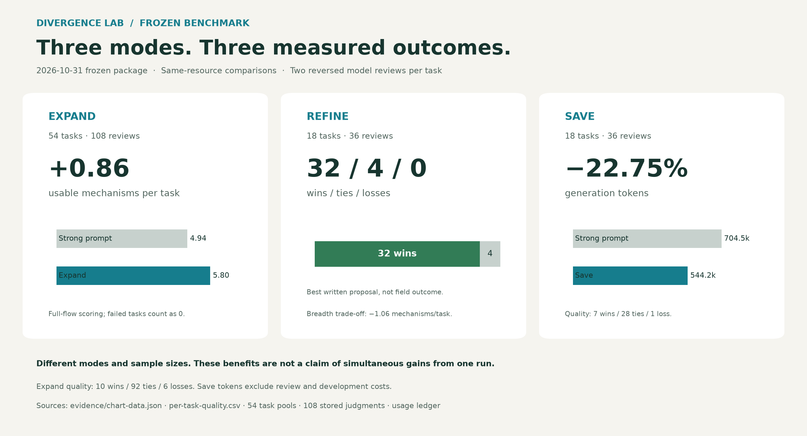
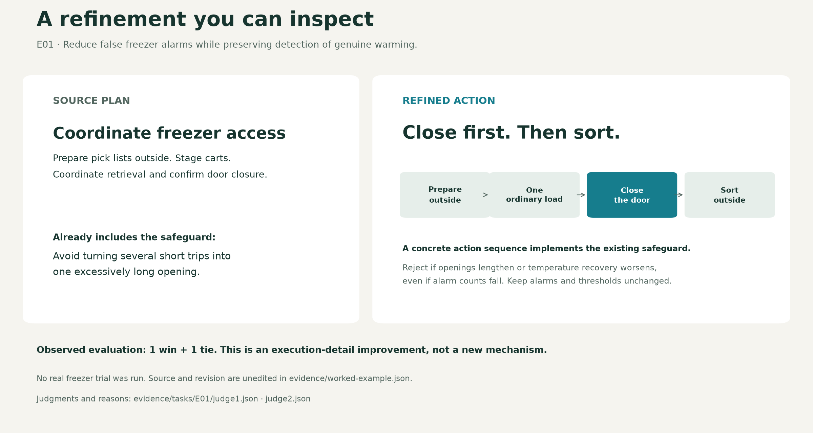
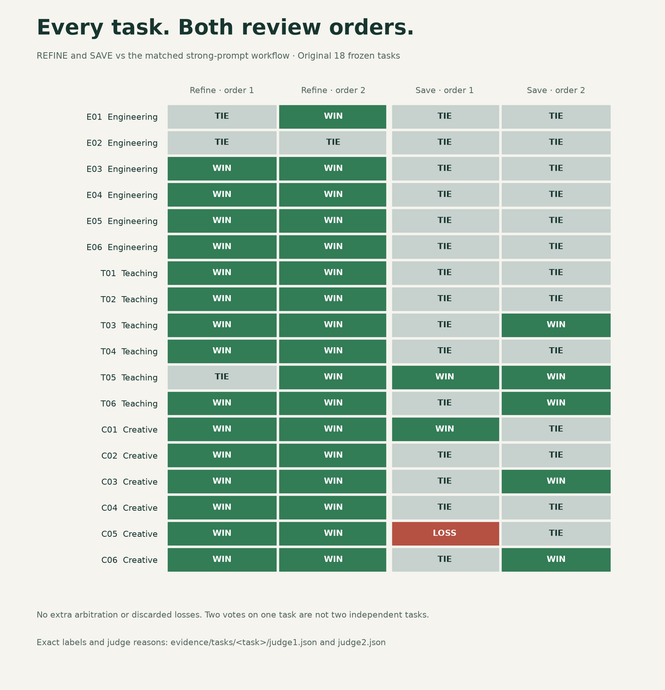

# Divergence Lab

**探索不同机制的路线，把好方案完善到具体动作。**

一个面向 Codex 的方案探索 Skill。围绕同一份任务与约束，保留已有方案，按需要继续拓展、精修，或复用结果以降低生成开销。



## 三个值得关注的结果

| 你想做什么 | 对应模式 | 已观察到的结果 | 直接证据 |
|---|---|---|---|
| 找到不同工作原理的解法 | **拓展** | 54 道冻结新题，平均多 **0.86 种有效机制** | [计算数据](evidence/chart-data.json)、[54 题分领域汇总](evidence/frozen-summary.json) |
| 让已有好方案更容易执行和检查 | **精修** | 18 道冻结新题、36 次反序评审：**32 胜、4 平、0 负** | [逐题结果](evidence/per-task-quality.csv)、[评审索引](EVIDENCE.md) |
| 用更少生成开销保留可选方案 | **省费** | 同一批 18 题，生成 token **减少 22.75%**；42 次调用，对照为 54 次 | [用量原记录摘录](evidence/generation-ledger.json)、[逐任务记账](evidence/task-metrics.json) |

这里比较的是 **2026-10-31 冻结版**与匹配资源的完整历史强提示流程。三种模式对应不同选择，不能把三项收益描述为一次调用同时取得。精修的有效机制平均少 1.06 种；省费的质量判断是 7 胜、28 平、1 负。评审衡量书面方案，不代表现实实施结果。

## 精修到底改了什么

任务 E01 要在不关闭报警、不故意加热食品的条件下，减少冷柜温度误报。

原方案已经提出在柜外准备取货，并避免一次开门过久。精修把这个要求落实为一个明确动作顺序：**柜外准备 → 取一份常规负载 → 完全关门 → 柜外分拣**。同时保留报警设置，并明确：即使误报减少，只要开门时间变长或温度恢复变慢，就应否定这次改法。



这不是新增一种机制，而是同一机制的执行细化。两次评审为一胜一平。[原方案与精修全文](evidence/worked-example.json) · [评审一](evidence/tasks/E01/judge1.json) · [评审二](evidence/tasks/E01/judge2.json)

## 怎么使用

用自然语言给出目标、约束和已有资源，然后继续对话：

```text
帮我探索降低维修预约爽约的办法。只有纸质预约簿、电话和两名志愿者。

继续拓展，找不同工作原理的路线。

精修第二个方案，把现场执行和异常处理写清楚。

复用上一轮的方案，这次优先降低生成成本。
```

拓展、精修、省费是同一个 Skill 的可选动作；任务、约束和旧方案持续保留。普通使用者不需要手工构造 JSON。

本页保留 2026-10-31 冻结版历史结果。当前候选 4 的安装与使用入口见 [README](README.md)；这些历史拓展成绩不归给新版。

## 从汇总数字追到逐题证据

下面展示首批 18 题的每一张精修和省费质量票，包含省费的负票。每题两次匿名评审，第二次反转方法顺序。



[全部证据索引与计算口径](EVIDENCE.md)提供：

- **54 份题目与完整方案池**，可直接检查约束、方案内容和机制是否不同。
- **108 份有效评审判决**，包含方法映射、可用方案、机制分组、最佳方案与判决理由。
- **276 个唯一生成请求的尝试用量记录**；不同模式共享相同请求，统计调用时按各自完整流程计账。
- **冻结提示模板与评审提示**、格式失败处理说明，以及源文件和导出文件的 SHA-256 对照。
- **离线重算绘图脚本**：从上述记录重新计算数字和生成图表，不需要再次调用模型。

```bash
python -m pip install -r requirements-figures.txt
python tools/render_figures.py
```

## 结果边界

拓展的 54 题质量结果为 **10 胜、92 平、6 负**，生成 token 约多 0.48%。服务流程类是弱项：平均机制增益为 0，质量 0 胜、7 平、5 负。原定工程、教学、创意三类中至少两类平均增加一种机制的门槛没有达到。

一份拓展生成和一份对照生成出现格式失败，按完整流程口径对失败任务计分；部分合法方案池仍保留用于描述。无效评审格式的同提示重试另有记录，没有增加裁判来翻转有效判决。

后续修复候选使用开发回归题，其成绩不进入本页主图。当前材料没有证明修复版的新题泛化、真实用户满意度或现实业务收益。精修的 36 张票也不是 36 个独立任务。

## 反馈与贡献

最有价值的反馈是可复现的失败案例：提供任务目标、硬约束、可用资源、所用版本和模式、完整输出，以及具体哪里不可执行或重复。可以提交改法，但应连同受影响案例和回归结果一起比较。

原逐题调参任务仍暂停。固定候选 4 的新题补测另行开展；历史冻结成绩保持不变。
