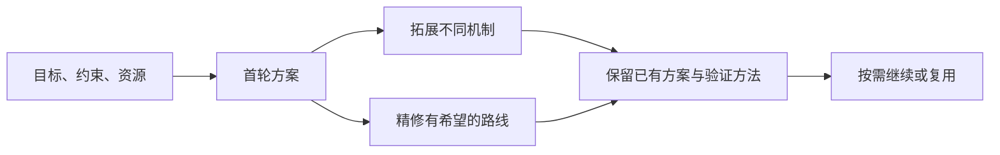

# Divergence Lab

**把一个问题，展开成不同机制的解决路线。**

一个面向 Codex 的发散思考 Skill。适合工程设计、教学实践、服务流程和开放创意：给出目标、限制与可用资源，探索多条路线，再把值得尝试的方案补成具体动作和验证计划。

[快速开始](#快速开始) · [输出示例](#一个真实例子) · [测试证据](#测试与证据) · [Skill 源文件](.agents/skills/divergence-lab-unified/SKILL.md)

## 它能帮你做什么

- **换机制思考。** 从预防问题、改变行为、调整流程、提供恢复路径等角度探索，说明每条路线为什么可能有效。
- **把想法落到行动。** 每条方案包含成立前提、资源与取舍，以及一个可以检查它是否有效的小实验。
- **沿着同一个问题继续。** 保留已有方案和约束，按需拓展、精修或节省生成调用，不必每轮重新交代背景。



## 快速开始

需要一个能正常使用的 Codex 环境。

**1. 下载仓库，在 Codex 中打开该文件夹。**

```bash
git clone https://github.com/yigongwugezi/divergence-lab.git
cd divergence-lab
```

也可以使用 GitHub 的 **Code → Download ZIP**。Skill 已放在仓库的 `.agents/skills/` 下，供 Codex 发现。

**2. 直接描述你的问题。**

```text
请使用 divergence-lab-unified，帮我探索降低社区自行车维修预约爽约的办法。

我们有两名志愿者，每周只开放两个半天，只有电话、纸质预约簿和候补名单。
不购买短信服务，不公开顾客姓名，也不使用黑名单。
先给出不同机制的路线，说明各自的前提、代价和小规模验证方法。
```

**3. 根据需要继续。**

| 你想做什么 | 可以这样说 |
|---|---|
| 找更多不同解法 | “继续拓展，寻找还没覆盖的工作机制。” |
| 完善已有方案 | “精修已有方案，重点补齐执行步骤和失败时的替代办法。” |
| 降低下一轮生成开销 | “沿用这个任务和已有方案，这次优先省费。” |
| 改变问题条件 | “现在只剩一名志愿者，请按这个新约束重新开始。” |

无需手写 JSON 或手工拼接提示。改变目标或约束后会作为新任务处理。

<details>
<summary>在已有项目里使用</summary>

将本仓库的 `.agents/skills/divergence-lab-unified/` 整个文件夹复制到你的项目下相同位置，保留项目原有的其他 Skill。若未出现在可用技能中，重新打开 Codex。

Codex CLI / IDE 也支持通过 `$divergence-lab-unified` 显式调用。技能目录与发现方式见 [OpenAI 官方说明](https://learn.chatgpt.com/docs/build-skills#where-codex-loads-local-skills)。

</details>

## 一个真实例子

针对上面的维修预约问题，存档输出包含这些路线。下面是原方案的简要概括：

| 路线 | 改变的机制 |
|---|---|
| 自愿电话提醒 | 减少遗忘，并及时获知取消意愿 |
| 临近服务日期再预约 | 缩短承诺与实际行动之间的间隔 |
| 弹性到场窗口 | 让小幅迟到不至于变成整次失约 |
| 代理送修 | 将服务与车辆绑定，减少本人必须到场的限制 |

对电话提醒路线，输出进一步明确了操作边界：**每个开放半天最多联系四人，总共十分钟；改期须复述并获得明确同意；未接电话不释放预约。** 验证计划同时观察爽约、空档、等待和志愿者耗时，发生误取消就暂停检查。

这使方案可以被讨论和试行。是否真的降低爽约，仍需现场验证。

[阅读完整任务与全部方案](evidence/candidate4/S01/task-and-pools.json) · [查看评审理由](evidence/candidate4/S01/judge1.json)

## 工作方式

首轮生成最多三条路线；随后根据你的要求继续。拓展寻找未覆盖的机制，精修改善已有路线的关键弱点，省费按已有结果选择较短的生成流程。精修得到的同机制改进版不会额外算作一种新机制。

内置 Python 脚本可通过已配置的 Codex CLI 发起独立请求，将结果保存在 Skill 的 `state/` 目录，用于继续和中断恢复。使用这条路径需要 Python 3 和可用的 Codex CLI；没有独立请求渠道时，可以在当前对话中完成方案探索，此时不承诺独立请求的 token 节省。

## 测试与证据

仓库保留题目、完整方案池、模型评审理由和用量记录，方便检查改进发生在哪里。

| 观察到的结果 | 样本与范围 |
|---|---|
| **11 / 13 题**达到质量改善且机制数量不减少的目标 | 当前版本的开发回归集；两次反序评审合计 19 胜、6 平、1 负 |
| 精修 **32 胜、4 平、0 负** | 未变精修组件的历史 18 题；平均有效机制比对照少 1.06 种 |
| 省费生成 token **减少 22.75%** | 未变省费组件的历史 18 题；质量评审为 7 胜、28 平、1 负 |

以上来自书面方案的模型评审，不是实际业务收益；开发题成绩也不是未见题胜率。不同模式的收益分别测量。当前发布为预览版，新题评估和真实 CLI 端到端验证的状态见版本说明。

[完整证据索引](EVIDENCE.md) · [逐题结果图](assets/candidate4-regression.png) · [版本与验证范围](docs/VERSION_NOTES.md) · [历史实验](HISTORICAL_RESULTS.md)

## 反馈

欢迎提交 [Issue](https://github.com/yigongwugezi/divergence-lab/issues)：附上你的目标、约束、使用版本和输出，并指出哪条路线重复、违反条件或无法执行。具体失败案例最有助于改进。

当前尚未提供开源许可证。
