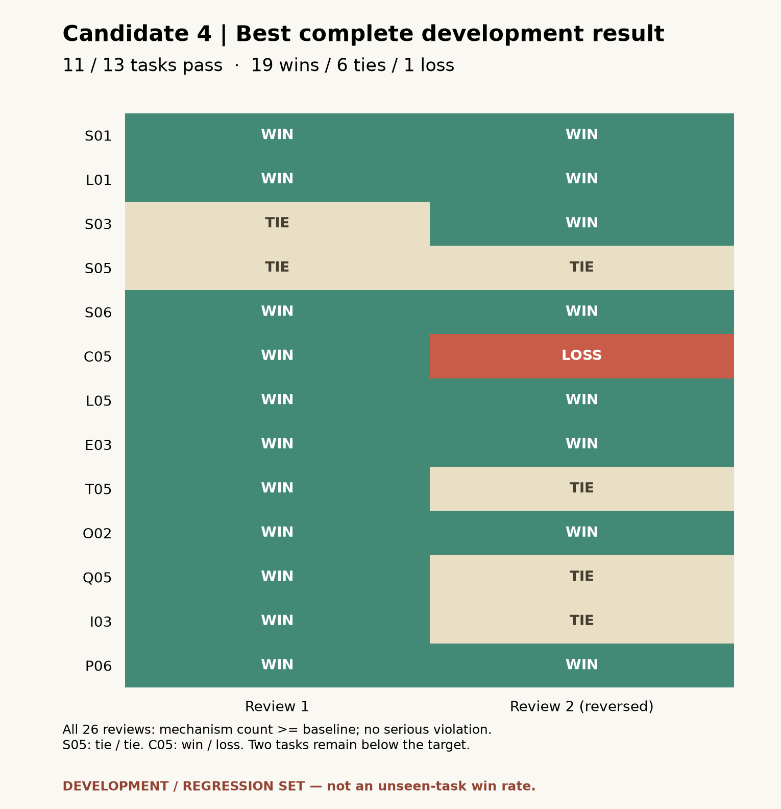

# Divergence Lab

**先探索不同机制的解法，再把有希望的方案写到能执行、能检查。**

Divergence Lab 是一个方案探索 Skill：围绕同一个目标和约束，保留已有方案，继续寻找不同工作原理的路线，也可以完善选中的路线，或优先复用已有结果降低生成开销。

这是固定候选 4 的实验性预览版。Skill 位于 `.agents/skills/divergence-lab-unified/`；在支持工作区 Skill 的 Codex 项目中放入该目录后，即可直接用自然语言提出目标。当前未提供许可证。

## 为什么值得试

- **发散有明确对象。** 区分不同工作机制，而不只增加同一种方案的措辞变体。
- **保留方案的连续性。** 沿用任务约束和已有方案，支持继续探索、精修和结果复用。
- **把可执行性作为改进方向。** 将适用条件、执行动作、检查方式和退出条件落到方案中；实际效果仍需实施检验。
- **结果可以逐题核查。** 同时提供题目、完整方案池、反序评审和不成功的案例。

## 当前版本做到什么



候选 4 在一组 **13 道开发回归题**中有 **11 道通过既定目标**：每题两次反序评审至少一胜一平、无负票，两次有效机制数量均不低于匹配基线，且没有严重违例。26 张质量票合计 **19 胜、6 平、1 负**，有效机制数量在全部 26 次评审中均不低于基线。

两道未通过题保留在统计中：**S05 为两平；C05 为一胜一负**。这些题已经用于改进方法，且候选 4 是比较候选后选出的最好完整结果，所以 **11/13 不是未见新题胜率**。这里比较书面方案质量，不代表方案已在现实中取得效果。

[13 题结果与判决理由](evidence/candidate4/summary.json) · [S05 完整方案池](evidence/candidate4/S05/task-and-pools.json) · [C05 完整方案池](evidence/candidate4/C05/task-and-pools.json) · [源文件校验索引](evidence/candidate4/PROVENANCE.json)

## 旧证据哪些仍有用

精修、省费的相关提示模板、路由脚本及输出约束与 2026-10-31 冻结版逐文件一致。因此，旧版针对相同任务、历史输出及请求流程的证据可以作为这两个组件的历史证据；这不等于候选 4 的全部对话体验已重新测过。

| 组件 | 既有证据 | 必须同时保留的限制 |
|---|---|---|
| 精修 | 原冻结版 18 道新题，36 次评审：32 胜、4 平、0 负 | 有效机制平均比完整强提示少 1.06 种；适合完善方案，不替代拓展 |
| 省费 | 原冻结版相同 18 题，生成 token 减少 22.75%，调用 42 次，对照 54 次 | 质量 7 胜、28 平、1 负；数字仅含对应生成流程，不是项目总费用或现金节省 |
| 拓展 | 候选 4 的直接证据是上面的 13 题开发回归 | 四份拓展模板已改，旧版 54 题平均多 0.86 种机制不能直接算作候选 4 的新题效果 |

[组件哈希对照](evidence/candidate4/component-identity.json) · [历史实验的完整证据与口径](EVIDENCE.md)

三种动作服务不同需求，不能把各自收益合并为“一次运行同时更广、更好、更便宜”。

## 使用方式

用户用自然语言说明目标、约束和资源，例如：

```text
帮我探索降低维修预约爽约的办法。只有纸质预约簿、电话和两名志愿者。
继续拓展，找不同工作原理的路线。
精修第二个方案，把具体执行和停止条件写清楚。
沿用这些方案继续，这次优先节省调用。
```

这些是预期交互示例，普通用户不需要手工编辑 JSON。存档响应的离线回放已通过状态保存、历史保留、任务变更保护和新进程恢复检查，见[本地回放证据](evidence/usability/LOCAL_REPLAY.json)。它使用替代生成器，不代表真实 CLI 调用成功；独立 CLI 的“开始—继续—保存—新进程恢复”真实流程仍待集中验证。无独立请求渠道时，Skill 可在当前聊天给出方案，但不能主张隔离请求的 token 节省。

## 版本与适用范围

本预览固定 **superiority-candidate4-20261102** 的行为，运行脚本、提示模板和 schema 与该候选逐字节一致。候选 4 是目前最好完整开发回归结果；较新候选没有同等完整的胜出证据。

当前更适合需要多路线思考、明确取舍和小规模验证计划的用户试用。尚未证明最新拓展方法在未见任务、不同模型、真实用户或真实业务指标上稳定领先。

计划补测 18 道新题，采用同一固定候选与匹配强提示；题目已冻结，集中评估正在进行。结果尚未产出，故这里不预填新题胜率、机制收益或成本结论。历史 54 题对应旧拓展模板，不能算作候选 4 的新题成绩。

[证据口径](EVIDENCE.md) · [历史结果](HISTORICAL_RESULTS.md)
